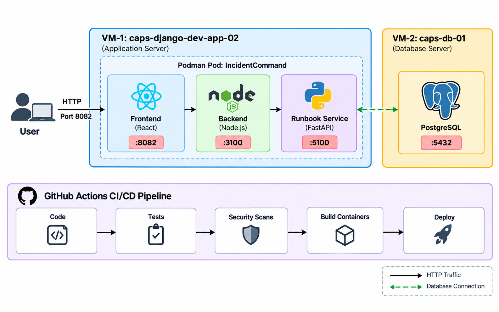

# IncidentCommand

## Overview

IncidentCommand is an incident management platform designed to help organizations track incidents, coordinate responders, manage alerts, and access standardized response procedures.

The platform brings these functions together into a centralized system, giving personnel a more organized way to manage incidents and support operational decision-making.

We aim to enhance **reliability, security, and scalability**. We are building the application using a service-based architecture supported by automated testing, containerization, and continuous integration.

## Platform Architecture

IncidentCommand consists of four primary components:

- **Frontend — React:** Provides the user interface for interacting with the platform.
- **Backend — Node.js:** Handles application logic and communication between services.
- **Runbook Service — Python/FastAPI:** Supports standardized incident response procedures.
- **Database — PostgreSQL:** Stores incident records, responder information, alerts, and runbooks.

These components are supported by **Podman** for container management and GitHub Actions for automated development and deployment workflows.

## Development Progress

### Sprint 0 — Infrastructure and Development Foundation

We established the foundation for IncidentCommand by configuring our development infrastructure, version control, and application architecture.

We also introduced a CI/CD pipeline to automate code validation, security checks, and container builds. This created a consistent development workflow and established the foundation for future deployments.

### Sprint 1 — Core Platform Development

We focused on developing the application's core services and database infrastructure.

This included building the frontend and backend structure, implementing the Python runbook service, and configuring PostgreSQL to manage incident-related information.

These components established the foundation for incident tracking, responder coordination, and response management.

### Sprint 2 — Security, Containerization, and Integration

We strengthened the platform's security and deployment capabilities.

Using **Snyk and OWASP Dependency-Check**, we introduced dependency vulnerability scanning to identify security risks in third-party software. We also addressed a critical vulnerability discovered during testing by upgrading the affected dependency.

We containerized our application services using **Podman**, allowing them to operate in consistent, isolated environments. We also integrated automated security checks into our GitHub Actions pipeline to help prevent critical vulnerabilities from reaching production.

This sprint established a more secure, repeatable process for building, testing, and deploying IncidentCommand.

## Project Direction

Our objective is to deliver a reliable incident management platform supported by a secure and automated deployment process.

As development progresses, our priorities include improving application functionality, strengthening service integration, and maintaining consistent security standards.

IncidentCommand is being developed with long-term maintainability in mind, allowing the platform to evolve as operational requirements change.
## DevOps Team 4121

| Name | Email | Github | Role | 
| ---- | ----- | ------ | ---- |
| Lincoln Koskela | koske113@umn.edu | LincolnKoskela | Project Lead |
| Faiso Hussein | husse553@umn.edu | faisoabdirisak | Sprint Cordinator | 
| Fenky Wah | wah00021@umn.edu | fenkur | Reviewer / QA |
| Kirubail Yenew | yenew004@umn.edu | KirubailSchool | Tech Lead |
| Vang Thao | thao1102@umn.edu | vangthao-1102 | Documentation | 

## Jira Board 
| Sprint # | 
| -------- |
| [Sprint 1](https://inet4121-spring-2026.atlassian.net/jira/software/projects/INET/boards/34/backlog) | 
| [Sprint 2](https://inet4121-spring-2026.atlassian.net/jira/software/projects/INET/boards/34/backlog) |

## Port Status
| Port # | Service | 
| ------ | ------- | 
| 8082 | User | 
| 8082 | Frontend (React) | 
| 5100 | Runbook Service | 
| 3100 | Backend (Node.js) | 
| 5432 | Database | 

## System Architecture

## Links

- [Team Charter](https://docs.google.com/document/d/1sV1QwH8ecxSYxVmtXZKglf6mhgYD3GBoIoWfkIKETIA/edit?tab=t.0)
- [Sprint 1](https://inet4121-spring-2026.atlassian.net/jira/software/projects/INET/boards/34/backlog)

